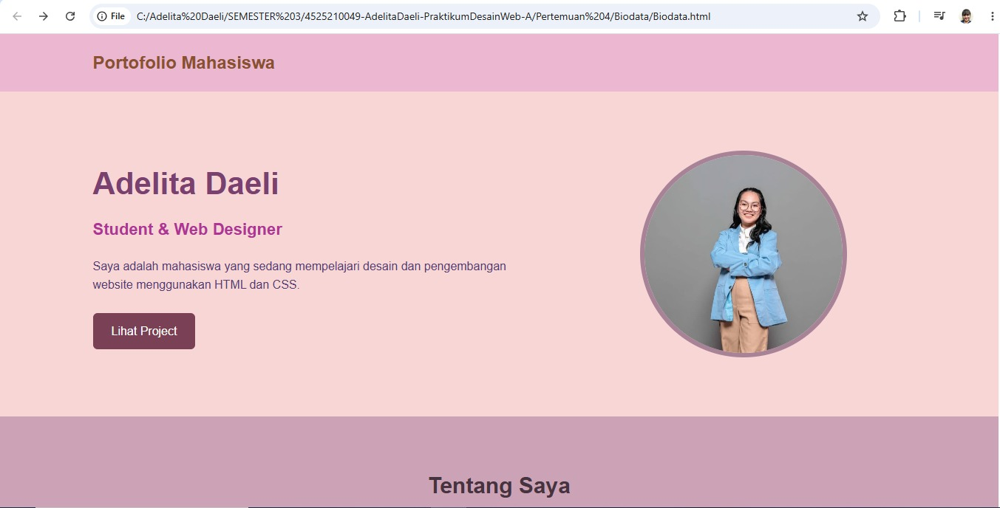
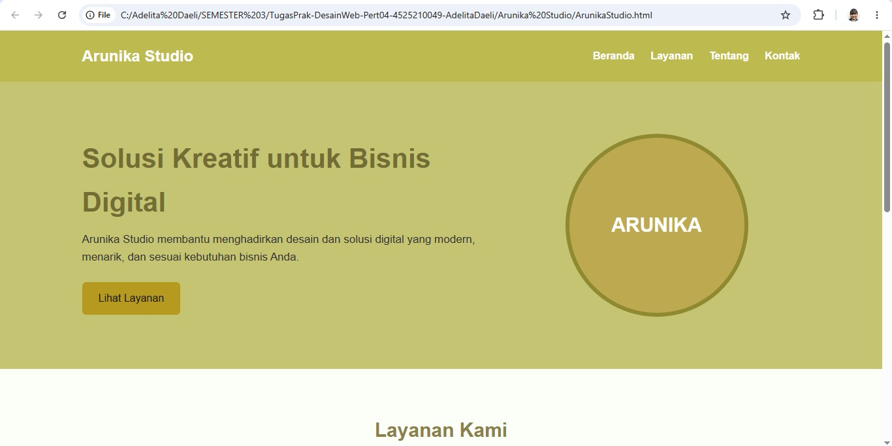

🌐 **Personal Portfolio Website - Adelita Daeli**
Website portofolio pribadi berbasis HTML5 dan CSS3 yang dirancang secara responsif (responsive web design) untuk menampilkan profil, keahlian, serta proyek-proyek akademis dan desain.

📌 **Daftar Isi**
1. Gambaran Umum
2. Fitur Utama
3. Teknologi yang Digunakan
4. Daftar Proyek
5. Struktur Folder
6. Cara Menjalankan Proyek
7. Kontak

📖 Gambaran Umum
Proyek ini merupakan halaman portofolio interaktif yang memuat informasi seputar profil mahasiswa, latar belakang pendidikan/keahlian di bidang Web Design, serta galeri proyek yang pernah dikerjakan. Halaman ini dirancang agar nyaman diakses dari berbagai ukuran perangkat, mulai dari smartphone, tablet, hingga desktop.

✨ **Fitur Utama**
- Header & Navigasi Interaktif: Navigasi cepat menuju setiap bagian halaman dengan efek smooth scrolling.
- Hero Section: Pengenalan singkat profil diri beserta foto profil yang dikustomisasi secara simetris.
- Section Tentang Saya: Ringkasan ketertarikan dan keahlian di bidang pengembangan antarmuka web.
- Galeri Proyek (Card Layout): Tampilan kartu proyek yang rapi dengan efek hover interaktif.
- Desain Responsif: Tata letak fleksibel menggunakan CSS Flexbox dan Media Queries (support Mobile & Tablet).
- Bagian Kontak: Tautan langsung ke Email dan akun Instagram.

🛠️ **Teknologi yang Digunakan**
- HTML5: Struktur dan semantik konten web.
- CSS3: Penataan gaya, skema warna, Flexbox layout, animasi hover, dan responsivitas (Media Queries).
- Google Fonts / Standard Fonts: Arial, sans-serif.

📂 **Daftar Proyek yang Ditampilkan**
- Personal Portfolio & Interactive Resume
- Deskripsi: Desain portofolio pribadi menggunakan Figma dan pembuatan resume interaktif menggunakan HTML & CSS.
- Tugas Besar Algoritma dan Pemrograman (C++)
- Deskripsi: Implementasi logika dan struktur pemrograman C++ untuk pemecahan masalah akademis.
- Tugas Besar Algoritma Sistem Data (C++)
- Deskripsi: Penerapan struktur data dan algoritma pemrosesan data menggunakan C++.

## 📷 Pratinjau Tampilan (*Preview*)
**Output Biodata**

**Output Arunika studio**

📁 Struktur Folder
Plaintext
.
├── css/
│   └── style.css           # File utama tata letak dan gaya CSS
├── images/
│   ├── potoku.png          # Foto profil utama
│   ├── portofolio.jpeg     # Thumbnail proyek portofolio
│   ├── Tubesalpro.jpeg     # Thumbnail proyek Alpro
│   └── Tubesasd.jpeg       # Thumbnail proyek ASD
├── index.html              # File HTML utama
└── README.md               # Dokumentasi proyek
🚀 Cara Menjalankan Proyek
Clone Repositori ini:

Bash
- git clone https://github.com/username-anda/nama-repo.git
- Buka folder proyek:

Bash
- cd nama-repo
- Buka file index.html:
- Klik ganda pada file index.html untuk membuanya di browser (Chrome, Edge, Firefox, dll.), ATAU
- Gunakan ekstensi Live Server di VS Code untuk pengalaman pratinjau terbaik.

✉️ **Kontak**
Nama: Adelita Daeli
Email: adelitadaeli@gmail.com
Instagram: @adelitaa_09
© 2026 FTUP. All Rights Reserved.
